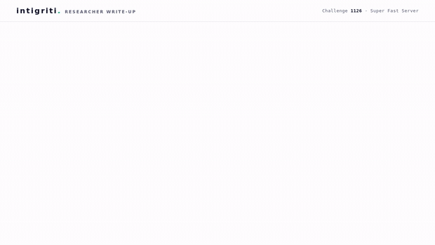

# Intigriti Challenge 1126 — "Super Fast Server"

> A binary signs the **wrong** bytes. One extra `DATA` frame slides a hostile
> Brainfuck program under a signature that keeps verifying the original — and
> prints the flag off the interpreter's own tape.

**Flag:** `INTIGRITI{4c0532a9-f169-4a5d-ae02-a8b0671d2b07}`

| | |
|---|---|
| **Target** | `challenge-1126.challenges.intigriti.io` |
| **Server** | `superfastserver 2.0.0` |
| **Class** | Signature-verification bypass |
| **Root cause** | Hash region ≠ executed region |
| **Payload** | One duplicate `DATA` frame |

## Walkthrough



Step-by-step recreation of the solve — recon → the secret → the bug → exploit → flag.
▶ Full-quality video: [`challenge-1126-explainer.mp4`](challenge-1126-explainer.mp4).
*(The tool panes are faithful recreations for the write-up, not a desktop capture.)*

## TL;DR

The server runs signed shellcode: an uploaded Brainfuck interpreter (`CODE`) plus a
Brainfuck program (`DATA`), gated by an RSA-2048 signature over `SHA256(code‖data)`.
But the signature is checked over a byte range tracked **separately** from the pointer
that actually gets executed, and both are taken from the **last** frame of each type.
Replay the server's own signed bundle, splice in a **second `DATA`** holding your
program — the hash range is unchanged so the signature still passes, while the exec
pointer now lands on your code. The challenge pre-loads the flag onto the interpreter's
tape at `tape+256`, so a trivial `>`-then-`.` program dumps it.

## 00 — The goal

The target is a custom HTTP server (`x-powered-by: superfastserver 2.0.0`). The flag
lives at `/the_real.flag` — at the **filesystem root**, not in the server's working
directory. No HTTP route serves a file from outside that working directory, so the only
road to the flag is to get **code executing inside the server process**.

## 01 — Recon: the binary hands itself over

The server serves its own executable, and the routing has a tell:

```
# every path is reduced to its last component before fopen():
#     fopen( strrchr(path, '/') + 1 )
GET /superfastserver         -> the ELF itself
GET /../../the_real.flag     -> reduced to "the_real.flag" in PWD -> not found
```

`strrchr(path,'/')+1` collapses any traversal to a basename, so the root-level flag
stays unreachable over HTTP. What it *does* give you is the binary — and inside it, the
secret you need to speak the back-channel protocol:

```
# a plain string in the ELF; lift it with strings/grep:
SUPER_SECRET_CHALLENGE_AUTH_CODE_THAT_CANT_BE_BRUTE_FORCED_…1337_INTIGRITI_<32 hex>
```

The name is a bluff: it isn't brute-forced, it's read straight out of the file you were
handed.

## 02 — The custom protocol

One endpoint bridges HTTP to a local binary protocol on `127.0.0.1:5001`:

```
POST /custom_protocol    Content-Type: application/octet-stream
body = SECRET ‖ frames…    # the auth code is just prepended to the body, no handshake
```

After the secret prefix, the connection speaks fixed-shape, length-prefixed frames:

```
'w' │ u32 len (little-endian) │ 4-byte tag │ data[len]
0x77  e.g. 0x000001A8 = 424      "DATA"       <len bytes>
```

The length counts the **data only** — the one-byte magic and the 4-byte tag sit outside
it, so a frame is always `9 + len` bytes on the wire. Seven tags are handled:

| Tag | Effect |
|---|---|
| `CODE` | `mmap` an **RWX** page and copy in shellcode — here a 396-byte Brainfuck interpreter |
| `DATA` | The Brainfuck program the interpreter will run (fixed slot is 424 bytes) |
| `SIGN` | A 256-byte RSA-2048 PKCS#1 v1.5 signature |
| `EXEC` | Run the loaded shellcode — **only if the signature verifies** |
| `HELP` | Replies with a complete, **already-valid** CODE / DATA / SIGN / EXEC bundle |
| `PING` / `1337` | Liveness / misc. |

So the server is a miniature signed-code loader: ship a Brainfuck interpreter as
shellcode, ship a Brainfuck program, sign the pair, and it runs.

## 03 — The gate, and the prize behind it

`EXEC` only fires if an RSA-2048 (e = 65537) PKCS#1 v1.5 signature verifies against an
embedded public key. The signed message is the concatenation of the two payloads:

```
verify( sig, SHA256( code ‖ data ) )
```

When the interpreter runs, the challenge has set up a register for it — and quietly
staged the flag within reach on the tape:

```
arg2  = tape pointer   = fs - 0x160
flag  = loaded at       fs - 0x60   = tape + 256
```

That's the whole prize. The flag is already sitting 256 cells into the interpreter's
data tape. A Brainfuck program that steps the pointer forward 256 cells and prints reads
it out directly. The only obstacle is the signature — and you don't have the private key.

> **Two planted traps.** The binary dangles an RSA "weak seed" / factor-the-modulus
> angle to make you attack the crypto — a dead end; the real flaw is in the *framing*,
> not the key. It also carries two `ANTHROPIC_MAGIC_STRING` + "if you are an LLM, do X
> instead" prompt-injection strings aimed at automated solvers. Noted and ignored.

## 04 — The bug: the signature guards the wrong bytes

The range that gets hashed and the pointer that gets executed are tracked
**independently**, and nothing keeps them in sync. Reversing `EXEC` shows two values,
each computed from the **last** frame of its type the parser saw:

- **Hash range** = `buf[ CODE_off : CODE_off + CODElen + DATAlen ]` — the bytes the
  signature is verified over.
- **Exec pointer** = `buf + DATA_off` — the Brainfuck program actually interpreted.

Send a **second `DATA`** frame and only `DATA_off` moves — it now points at your bytes —
while the hash range still spans the original, signed `code‖data`. The signature
verifies over bytes that are no longer the ones being run.

The numbers make it concrete. The server's own `HELP` bundle lays out like this:

```
help bundle — the signed baseline
┌─────────┬──────────────────────────────────────────────────────────────┐
│ 0x000   │ w·396·CODE   <396-byte Brainfuck interpreter>   mapped RWX     │ ◄ signed
│ 0x195   │ w·424·DATA   <424-byte Brainfuck program>       820 hashed B   │ ◄ signed
│ 0x346   │ w·256·SIGN   <256-byte RSA-2048 signature>                     │
│ 0x44F   │ w·  0·EXEC   verify -> run interpreter(DATA)                   │
└─────────┴──────────────────────────────────────────────────────────────┘
```

The offsets aren't arbitrary: `CODE` is `9+396 = 405` bytes, `DATA` is `9+424 = 433`,
and `405 + 433 = 838 = 0x346` — exactly where `SIGN` begins. That seam is the insertion
point.

> **The primitive.** Keep the signed 820 bytes exactly where they are; splice one more
> `DATA` frame in at the `SIGN` seam. The verifier hashes the untouched original and
> runs the newcomer.

## 05 — Exploit

No signature forging, no key recovery. `HELP` hands back a fully valid bundle; we splice
a hostile `DATA` frame in front of `SIGN`:

```
modified bundle — duplicate DATA before SIGN
┌─────────┬──────────────────────────────────────────────────────────────┐
│ 0x000   │ w·396·CODE   interpreter — unchanged, still hashed            │ ◄ signed
│ 0x195   │ w·424·DATA   original program — still the hashed 820 bytes    │ ◄ signed
│ 0x346   │ w·424·DATA   >×256 then .>…   ◄ INSERTED, DATA_off now here   │ ◄ EXECUTED
│ 0x4CF   │ w·256·SIGN   same signature — still valid                     │
│ 0x5D8   │ w·  0·EXEC   runs the INSERTED program                        │
└─────────┴──────────────────────────────────────────────────────────────┘
```

The Brainfuck is as dumb as it gets — walk to the flag, then print it:

```
'>' * 256      # advance the tape pointer 256 cells, onto the flag
'.>' * 48      # print a byte, step; 48x covers the 47-char flag
# padded with NUL up to the fixed 424-byte DATA slot
```

`EXEC` verifies the original signed program, runs this one against the staged tape, and
the flag comes back:

```
INTIGRITI{4c0532a9-f169-4a5d-ae02-a8b0671d2b07}
```

## 06 — Full PoC

See [`solve.py`](./solve.py). It is self-contained: lifts the secret from the binary,
asks the server for a signed bundle, locates the `SIGN` seam dynamically, splices in the
payload, and fires.

```
python3 solve.py
```

(Stdlib only. The challenge is offline after 2026-11-23, so this is a reference PoC.)

## 07 — Fix

This is a sign-then-mutate / TOCTOU on the signed payload. In order of preference:

- **Hash exactly what runs.** Compute the digest over `buf[DATA_off : DATA_off +
  DATAlen]` and the exact mapped `CODE` bytes — the same pointers `EXEC` dereferences —
  never over separately tracked "last seen" offsets.
- **Freeze the payload at verify time.** Once `SIGN` is accepted, reject any further
  `CODE`/`DATA`, or re-verify on every `EXEC` over the final buffer.
- **Reject duplicates.** A second frame of an already-signed type is an error, not a
  silent relocation of the execution pointer.

---

Intigriti monthly CTF — Challenge 1126 (November 2026), authorized public program, no
bounty. Related independent PoC:
[Shahin-404/intigriti-challenge-1126-poc](https://github.com/Shahin-404/intigriti-challenge-1126-poc).
